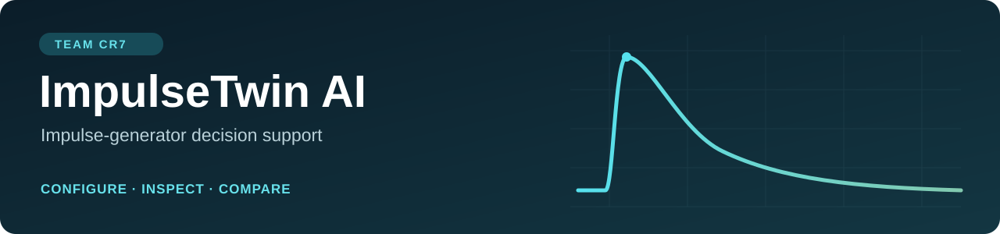
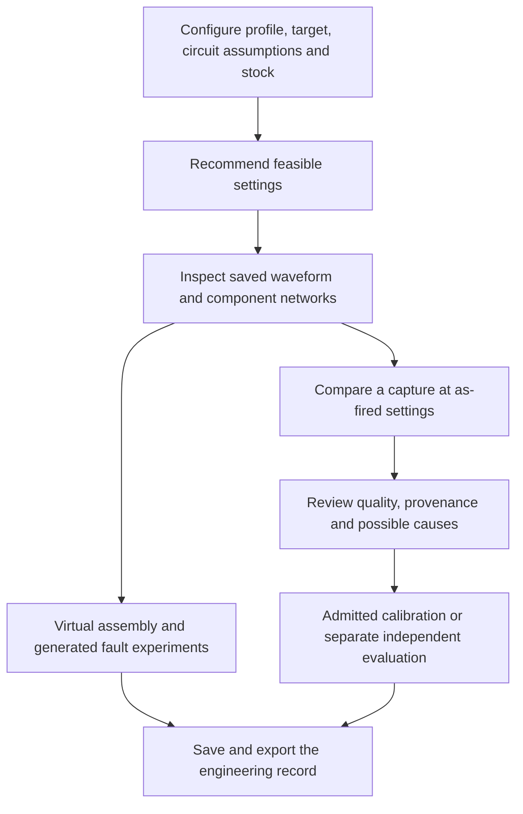

# ImpulseTwin AI

**Understand the waveform. Inspect the configuration. Prepare the next trial.**

ImpulseTwin AI helps engineers explore high-voltage impulse-generator settings before a physical trial. It brings circuit physics, counted-component search, scoped machine learning, waveform diagnostics and a conceptual assembly twin into one inspectable workflow.

Built by **Team CR7** for **PowerNext AI 2026 · Track 1**.

**[Live demo](https://cr7-impulsetwin-730856d9.azurewebsites.net/)** · **[Documentation](docs/README.md)**

## The problem

An impulse generator must deliver the required peak voltage and timing while respecting stage, voltage, energy and resistor-stock constraints. Engineers also need to inspect the component arrangement, assumptions, uncertainty and what changed after a trial.

ImpulseTwin connects those decisions, from a requested waveform to a saved configuration and a comparison with an uploaded capture.

## What you can do

| Capability | What it provides |
|---|---|
| **Recommend settings** | Ranked stages, charge and constructible front/tail resistor networks under the declared ratings and counted stock. |
| **Inspect the waveform** | Circuit curves, crest/timing metrics, target deviations, uncertainty checks and prediction-basis labels. |
| **Assemble digitally** | Interactive RLC assembly, component inspection and staged safety briefings in a conceptual twin. |
| **Explore faults** | Front/tail-chopped lightning impulses, reduced-charge conducting stages and assumed conductive bypasses at fixed charge. |
| **Diagnose differences** | Compare CSV or digitized plot images with the as-fired prediction and inspect competing explanations. |
| **Use capture feedback** | Admitted calibration, effective-parameter fitting, separate independent evaluation and recorded provenance. |
| **Explain and export** | Judge Mode, evidence views, saved history and HTML/JSON/CSV reports where supported. |

## The workflow



**CPRI recommendations use circuit physics.** The 12-stage / 0.125 µF CPRI reference stays separate from the 15-stage / 3 µF workbook benchmark. Frozen workbook residual ML is applied only inside its supported domain. [Architecture and technology stack →](docs/system_architecture.md)

## Technology

| Layer | Stack |
|---|---|
| Interface | Next.js, React, TypeScript, Tailwind CSS |
| Visualization | Apache ECharts, Three.js, Canvas and SVG |
| API | Python 3.12, FastAPI, Pydantic, Uvicorn |
| Engineering | NumPy, SciPy, pandas, scikit-learn |
| Records | SQLite, SQLAlchemy, versioned JSON and source checksums |
| Hosting | Azure App Service |

## Run locally

Use **Python 3.12**. The prepared frontend and frozen models are included; Node.js is needed only to rebuild the frontend.

```bash
git clone https://github.com/Siddhanthkjain2005/CR7.git
cd CR7
python3 -m venv .venv
source .venv/bin/activate
python -m pip install -r requirements.txt
python scripts/dev.py
```

Open **http://127.0.0.1:8000/**. On Windows, use `py -3.12 -m venv .venv` and `.\.venv\Scripts\Activate.ps1` for environment creation/activation. Installing dependencies needs internet; the prepared local inference workflow can run offline.

[Detailed setup and platform notes](docs/release_readiness.md) · [Contributor guide](CONTRIBUTING.md)

## Evidence, with its scope

| Recorded evidence | What it establishes |
|---|---|
| **36/36 expected outcomes** in the generated evaluation pack | Declared recommendation/rejection behavior under the assumed circuit; 14/14 bounded-versus-exhaustive comparisons matched. |
| **Seven numerical gates passed** for the fault study | Agreement with independent integration of the same equations: 34 resolved scenarios and four expected all-bypass rejections. |
| **Frozen workbook V1: 5/6 outputs better than kNN** | Preserved synthetic benchmark evidence. V2's separate development result does not replace it. |
| **Waveform Diagnostics: 7/8 gates passed** | Generated-fixture evidence; a second-tail component remains an ambiguous effective-resistance explanation. |
| **438 backend tests** in the recorded fault-release verification | Software regression coverage for that version; frontend checks and dated QA are recorded separately. |
| **Live Azure checks passed** | Pages/assets, evidence APIs, recommendation, four fault scenarios, diagnostics and saved records/image persistence after restart. |

These are distinct software and simulation results, **not a laboratory-accuracy percentage**. Independent CPRI measurements remain necessary to establish real-equipment agreement. [Evidence and limitations →](docs/README.md#evidence-and-validation)

## Repository structure

```text
backend/app/       API, physics, optimization, ML gates and records
frontend/          Next.js interface, charts and conceptual digital twin
config/            Generator profiles, compliance and search configuration
data/source/       Original challenge PDF, workbook and briefing transcript
data/              Processed and labelled generated data
artifacts/         Frozen models, protocols and completed study records
docs/              Architecture, workflow guides and engineering explanations
docs/validation/   Detailed optimization report
scripts/           Startup, audits and reproducibility utilities
tests/             Backend regression and numerical checks
presentations/     Team pitch deck
release/           Instructions for generating a reproducible package
```

## Team CR7

| Name | Role |
|---|---|
| **Adithya P** | Team lead |
| **Siddhanth K Jain** | Team member |
| **Kamma Rohan** | Team member |
| **Dinesh Kulkarni** | Team member |

## Scope of use

Engineering decision support: no hardware control, physical assembly/firing authorization, personal-safety certification or IEC certification. Unknown stock, ratings, mounting and measurement facts remain unknown. Generated captures and conceptual diagrams retain their labels.

Use **Issues** for reproducible questions or problems; include the branch, profile and reproduction steps.
