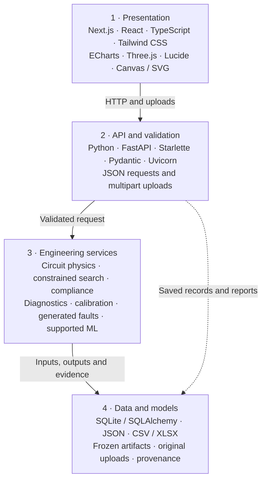

# System architecture

[← Documentation](README.md) · [Overview](../README.md)

One browser interface and one Python API. Next.js exports static assets; FastAPI serves those assets and the engineering endpoints from the same origin. Physics, gated ML and stored evidence run on the Python side.

## Layers

These are logical responsibilities, not a requirement that every request passes through every layer. History requests can read storage directly; serving a static page does not invoke the solver.

## Technology stack

| Area | Technologies | Role |
|---|---|---|
| Interface | Next.js 16, React 19 / React DOM, TypeScript, Tailwind CSS | Static pages, state and controls. |
| Visuals | Apache ECharts, local Three.js r170, Lucide, Canvas / SVG | Waveform charts, conceptual WebGL twin, icons and 2D fallback. |
| API | Python 3.12, FastAPI, Starlette, Pydantic, Uvicorn, python-multipart | Request validation, uploads and server. |
| Engineering | NumPy, SciPy, pandas | Circuit modes, crossings, search and parameter analysis. |
| Supported ML | scikit-learn, joblib | Frozen workbook residual models and support gates. |
| Imaging | Pillow, Matplotlib | Image processing and generated diagnostic plots. |
| Persistence | SQLite, SQLAlchemy, JSON, CSV / XLSX, joblib | Versioned inputs, records, sources and artifacts. |
| Build and checks | Node.js 22, npm, PostCSS, pytest, HTTPX | Frontend preparation and automated checks. |
| Support tools | openpyxl, pypdf, PyYAML | Workbook ingestion and declared document/configuration dependencies. |
| Optional experiments | XGBoost | Historical local V2 search dependency; not a required production inference service. |
| Hosted demo | Azure App Service, Linux, Python 3.12 | One B1 instance serving the frontend and API. |

Exact versions are declared in [`frontend/package.json`](https://github.com/Siddhanthkjain2005/CR7/blob/codex/assembly-twin/frontend/package.json), [`requirements.txt`](https://github.com/Siddhanthkjain2005/CR7/blob/codex/assembly-twin/requirements.txt) and [`requirements-experiments.txt`](https://github.com/Siddhanthkjain2005/CR7/blob/codex/assembly-twin/requirements-experiments.txt). Pillow is also a Matplotlib dependency. Three.js is supplied locally; no runtime CDN is required.

## Recommendation path

1. Validate the profile, target, circuit assumptions, ratings and stock provenance.
2. Search constructible stage/resistor combinations under the declared constraints.
3. Solve CPRI/custom circuit physics, or the separate workbook reference with its supported residual-ML gate.
4. Check waveform limits, uncertainty/scenarios and the ranking objective.
5. Save inputs, hardware, versions and evidence; run fixed-setting challenges without silently reranking.

Nominal charging voltage can be solved to meet a requested crest. Exact nominal crest does not establish zero physical measurement error.

## Capture feedback

Original bytes/checksum, origin, polarity, units and as-fired settings are recorded. Shared admission checks decide whether a capture can be used for its purpose. Calibration and independent evaluation remain separate. Digitized images support approximate diagnostics, not calibration or laboratory-accuracy evaluation.

Diagnostic fits are competing explanations under the model, not proof of a failed physical component. Generated faults save separate records and never become measured calibration/validation data.

## Execution and storage

Locally, `python scripts/dev.py` serves the prepared app at `127.0.0.1:8000`; `IMPULSETWIN_DB` selects the SQLite store. Node.js is used for frontend development/build, not as a second server required by the prepared app.

The Azure demo runs the committed application with a hosting launcher, one Uvicorn worker and bounded numerical-library threads. Application files, SQLite and uploaded originals reside in `/home/impulsetwin/app`. Originals physically remain within the application root, preserving file-containment checks. Saved recommendation/fault records and an original diagnostics image were verified after restart.

This public shared demonstration has no individual user authorization or production backup/multi-instance database design. Use generated examples. Physical operation and equipment interlocks remain outside the software.

[Detailed engineering ownership](https://github.com/Siddhanthkjain2005/CR7/blob/codex/assembly-twin/docs/architecture.md) · [Evidence scope](README.md#evidence-and-validation)
